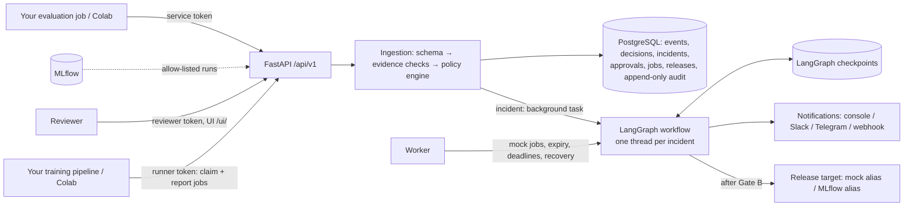

# Architecture

## Processes

**api**
- Ingests evidence, serves the API and the UI.
- Drives workflows right after events and decisions, as background tasks.

**worker**
- Runs mock jobs, expires approvals and enforces job deadlines.
- Resumes interrupted workflows and recovers missed wake-ups.
- Never runs user code.

**Coordination.** Both processes use the same database. A per-incident lease ensures
only one process advances a workflow at a time.

## Modules

| Module | Responsibility |
|---|---|
| `schemas/evaluation.py` | Canonical event schema v1 (structure only) |
| `metrics/` | Metric metadata (direction, range), reference implementations, evidence checks |
| `policies/` | Policy schema (models, pipelines, release targets), fail-closed loader with content-hash version, pure engine |
| `services/ingestion.py` | Idempotent single-transaction persistence of event, decision, incident and audit |
| `services/approvals.py` | Gate requests, decisions (exact spec digest), expiry, re-validation before side effects |
| `jobs/` | Job lifecycle, result schema, mock runner, worker loop |
| `deployment/` | Release adapter contract; mock and MLflow-alias adapters |
| `evaluation/mlflow_adapter.py` | MLflow REST client: runs → events, registry aliases |
| `graph/` | `GovernanceState`, nodes, pure routing, builder, runner (checkpointer, leases, wake-ups) |
| `notifications/` | Provider protocol, console/none/Slack/Telegram/webhook, idempotent retried delivery |
| `api/` | Routes, role-based bearer auth, approvals/jobs/admin, body-size limit, reviewer UI |
| `storage/` | SQLAlchemy models, Alembic migrations 0001–0003 (bundled in the package) |
| `cli.py` | `doctor`, `demo`, `worker`, `add-reviewer`, `mlflow-import`, `migrate`, `serve`, … |

The policy engine is a pure function of (event, policy, baseline, receive time). The
same inputs always produce the same result and `result_digest`. No LLM is used
anywhere.

## Design decisions

1. **Explicit baselines.** A baseline is a `role: baseline` event on a fixed holdout.
   Monitoring events and candidates are compared only with a baseline on an
   identical model, target, dataset version and protocol.
2. **Evidence problems are incidents, not 422s.** A NaN metric leaves an auditable
   record. Non-finite values are stored as strings, because JSONB can't hold them.
3. **Unknown models fail closed.** They get an evidence incident with `UNKNOWN_MODEL`.
4. **Humans can't be configured away.** `require_human_*_approval` and
   `require_candidate_evaluation` accept only `true`.
5. **Approvals bind an exact spec.** Reviewers echo the `spec_digest`, and the digest
   is recomputed from current state before acting. Any change of policy, spec,
   candidate or reviewer authorization blocks the action.
6. **Three separated roles.** The service token can't approve. Reviewers use
   personal tokens, stored as hashes. The runner token only touches jobs.
7. **Pull-based external training.** Approved jobs are claimed by the user's own
   pipeline over HTTPS, so ML Sentry never executes code and never needs Docker
   socket access. Mock jobs exist for demos and tests.
8. **Two kill switches.** Non-mock execution needs the policy to allow it, a human to
   approve it, **and** an environment switch (`ML_SENTRY_RETRAINING_ENABLED` /
   `ML_SENTRY_DEPLOYMENT_ENABLED`).
9. **Durable, idempotent workflows.**
   - Checkpoints are written after every step (`durability="sync"`).
   - Waiting nodes re-read the database when woken.
   - Every side effect is keyed: one approval per gate, one job per approval, one
     release per approval, one notification per kind.
10. **Append-only audit.** The application only inserts audit rows, and on PostgreSQL
    a trigger rejects `UPDATE` and `DELETE`. This is not cryptographic immutability.
11. **Releases are verified and reversible.** A failed verification restores the
    previous reference. A registry alias change is documented as *not* being a
    deployment.
12. **Checkpoint tables belong to LangGraph.** They are created by
    `PostgresSaver.setup()` in `ml-sentry migrate`, outside the Alembic history.
13. **The optional LLM investigation is not implemented.** The `investigate` node is
    deterministic (recent history). An LLM summary could be added later behind an
    interface, but could never affect routing.
14. **No separate idempotency table.** Unique constraints on the domain tables do
    that job.
15. **License: MIT**, confirmed by the project owner.
