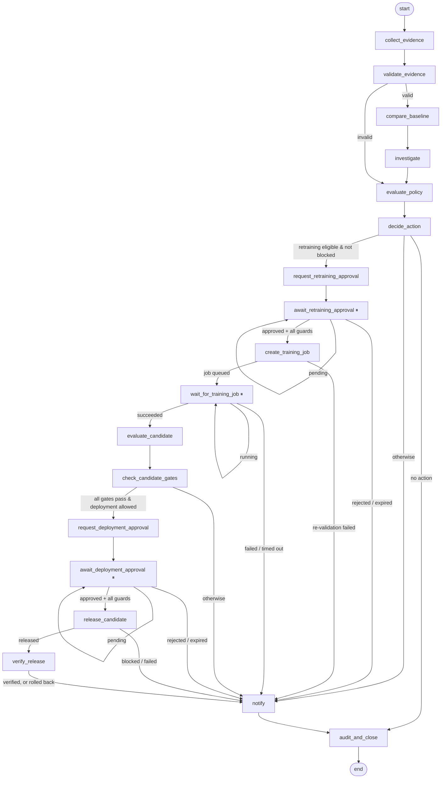

# Governance workflow (LangGraph)

Every incident gets its own durable LangGraph workflow, on thread
`incident-<incident id>`. Threads are never shared between incidents. Each step is
checkpointed to PostgreSQL. The workflow pauses (LangGraph `interrupt()`) while it
waits for a human decision or a training job, and continues when woken.

| Node | Purpose |
|---|---|
| `collect_evidence` | Loads the stored event, and the baseline chosen at ingestion as the champion's fixed holdout |
| `validate_evidence` / `compare_baseline` | Re-runs the deterministic evidence checks and computes metric deltas |
| `investigate` | Deterministic context: the model's recent evaluations and how many also breached policy |
| `evaluate_policy` | Re-runs the policy engine. If the result differs from the ingestion decision: `DECISION_MISMATCH`, notify only |
| `decide_action` | Checks retraining blockers: pipeline, environment switch, champion holdout, cooldown, attempts |
| `request_*_approval` / `await_*_approval` | Create the approval request (idempotent), notify reviewers, pause until decided or expired |
| `create_training_job` | Re-validates the approval, then creates the single job for it |
| `wait_for_training_job` | Pauses until the job succeeds, fails or times out |
| `evaluate_candidate` / `check_candidate_gates` | Candidate vs champion on the same holdout; see [training-adapters.md](training-adapters.md) |
| `release_candidate` / `verify_release` | Re-validates the approval, then releases once, verifies, and rolls back on failure; see [deployment.md](deployment.md) |
| `notify` / `audit_and_close` | Final notification, a `workflow.completed` audit event with the full route, and the incident status |

## Safety properties (all covered by tests)

- **Invalid evidence** never reaches an approval, training or release node.
- **No job without approval.** Training needs a valid Gate A approval, re-validated
  against the database. A forged approval in the state isn't enough.
- **Failed gates stop the loop.** A candidate that fails a gate never reaches
  Gate B, and the champion is untouched.
- **No release without Gate B.** A release needs a separate, valid Gate B approval.
  A rejected or expired approval ends the workflow without acting.
- **Material changes invalidate approvals.** A different policy version, spec,
  candidate or a revoked reviewer blocks the side effect.
- **No duplicates.** Duplicate events and repeated wake-ups create one incident and
  one job. Releases are keyed per approval.
- **Notifications can't change decisions.** Failed deliveries are only recorded.
- **Deterministic.** No LLM is used anywhere.

## Who drives the workflow

| Trigger | Actor |
|---|---|
| New incident | API background task, right after the response |
| Approval decided | API background task after the decision |
| External job result reported | API background task |
| Mock job finished, approval expired, job deadline passed | Worker |
| Pending or interrupted workflows, missed wake-ups | Worker sweep, every `ML_SENTRY_WORKER_POLL_SECONDS` |

**Leases.** A process may only advance an incident while holding its 5-minute
database lease, so the API and the worker never drive the same thread concurrently.
The workflow is resumed from its last checkpoint after any crash or restart. Waiting
nodes re-read the database when woken; the resume value is only a signal.

## Status values

| Field | Values |
|---|---|
| `workflow_status` | `pending` → `running` → `waiting` (for approval/job) → `completed`, or `failed` (see `workflow_error`) |
| Incident `status` | `open` → `awaiting_review` (a human must act), `closed` (nothing to do), or `resolved` (candidate released and verified) |

**Outcomes** (in the `workflow.completed` audit event):
- `no_action`
- `evidence_rejected`, `decision_mismatch`
- `awaiting_human_review`
- `retraining_blocked`, `retraining_rejected`, `retraining_expired`, `blocked`
- `training_failed`, `candidate_rejected`, `candidate_ready_deployment_blocked`
- `deployment_rejected`, `deployment_expired`
- `release_failed`, `release_rolled_back`, `release_rollback_failed`
- `released`

On SQLite (tests only), checkpoints are kept in memory and are not durable.
